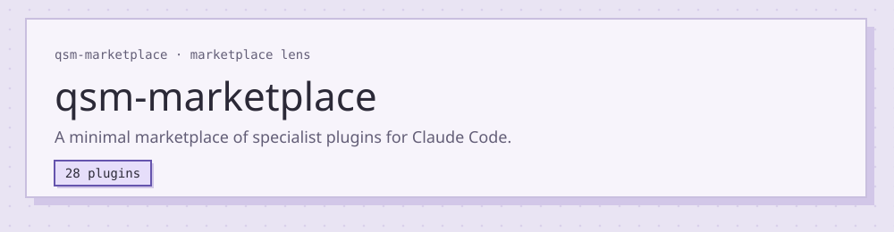
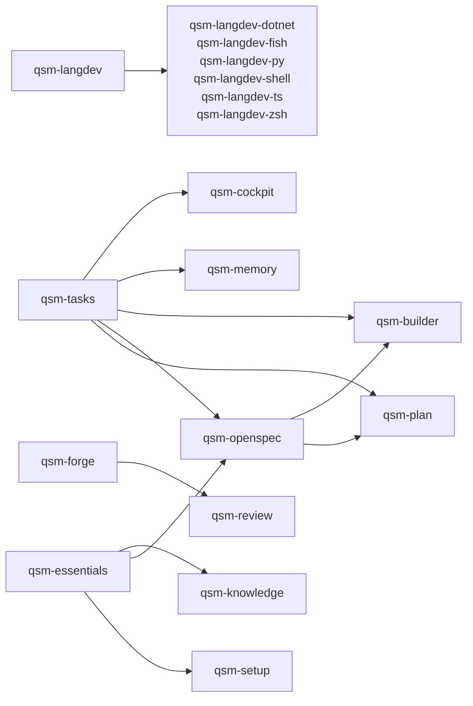

<!-- markdownlint-disable MD033 -->
<div align="center">

# `qsm-marketplace`

**Small Claude Code plugins that help an agent check its own work.**

[](https://github.com/Questi0nM4rk/qsm-marketplace/actions/workflows/ci.yml)
[](https://github.com/Questi0nM4rk/qsm-marketplace/actions/workflows/ci.yml)
[](https://github.com/Questi0nM4rk/qsm-marketplace/actions/workflows/ci.yml)
[](./LICENSE)

</div>

## Why it exists

An agent can do good work, and the harness it runs in gives it too few specialized
ways to see the world, verify its output, and evaluate what it made. qsm-marketplace
exists to close that gap for one hobbyist CLI and project maker who is a senior
programmer, and for the agent working beside them, so that both can meet the same
expectations. It is a minimal, specialist marketplace: straightforward instructions,
hooks, and tools that lead the agent to better, simpler, shorter, and more
specialized output, in the spirit of recursive language models and agent loops. It
refuses to be a general catalogue, a documentation mirror, or a place where a
capability lives twice. The day a plugin here stops making the agent's work simpler
to verify or shorter to read, it has no reason to exist.

<!-- lens:start -->
## What it is

<!-- markdownlint-disable MD013 MD033 -->
<picture>
  <source media="(prefers-color-scheme: dark)" srcset="assets/lens-banner-dark.svg">
  <source media="(prefers-color-scheme: light)" srcset="assets/lens-banner-light.svg">
  
</picture>
<!-- markdownlint-enable MD013 MD033 -->

Every capability is one plugin that carries its own code, CLI, skills, hooks and docs. The core
works alone. Every other plugin adds a capability or replaces a default, and names the plugins it
needs.

## How the plugins depend on each other

An arrow runs from a plugin to the plugin that uses it.



These plugins need no other plugin and no plugin needs them: `qsm-compuse`, `qsm-book-to-skill`,
`qsm-index`, `qsm-opencode`, `qsm-secrets`, `qsm-statusline`, `qsm-usage`, `qsm-toolbox`, `qsm-uix`,
`qsm-web`, `qsm-worktrunk`.

## Catalog

### Core

| Plugin | Why it exists | Ships |
| --- | --- | --- |
| [qsm-essentials](plugins/qsm-essentials/README.md) | Without a shared method, every session relearns how this person works: it builds before it understands, settles design by default, forgets what an earlier session decided, and either does everything itself or hands everything away. | 10 skills, 4 agents, 2 hooks |

### Planning

| Plugin | Why it exists | Ships |
| --- | --- | --- |
| [qsm-openspec](plugins/qsm-openspec/README.md) | A change that starts in code ends in code nobody can review against an intention. | 3 skills, CLI |
| [qsm-plan](plugins/qsm-plan/README.md) | Claude's default is to start building the moment an ask arrives, whatever its size: a five-line fix gets a project's ceremony, or a project gets built on a guess. | 2 skills |
| [qsm-tasks](plugins/qsm-tasks/README.md) | Work that outlives a session is lost unless one place outside the conversation holds it. | 2 skills |

### Code quality and languages

| Plugin | Why it exists | Ships |
| --- | --- | --- |
| [qsm-langdev](plugins/qsm-langdev/README.md) | An agent cannot see the quality of what it wrote until something outside it measures it, and by then the session is usually over. | CLI, 4 hooks |
| [qsm-langdev-dotnet](plugins/qsm-langdev-dotnet/README.md) | A model left alone writes C# from older habits than the SDK in use, and the compiler's analyzers cannot make the choices between records and classes, scoped and singleton, or what C# 14 added. | 1 skill |
| [qsm-langdev-fish](plugins/qsm-langdev-fish/README.md) | A model left alone writes fish as if it were bash: `set -e`, a `$status` read twice, a bare `set` that leaks scope. | 1 skill |
| [qsm-langdev-py](plugins/qsm-langdev-py/README.md) | A model left alone writes Python with loose hints and untidy structure. | 1 skill |
| [qsm-langdev-shell](plugins/qsm-langdev-shell/README.md) | A model left alone writes shell that leans on external tools and forgets the portable shebang, and the strict-mode traps are the part shellcheck cannot decide. | 1 skill |
| [qsm-langdev-ts](plugins/qsm-langdev-ts/README.md) | A model left alone writes TypeScript that compiles yet leaves meaning in loose strings and numbers. | 2 skills |
| [qsm-langdev-zsh](plugins/qsm-langdev-zsh/README.md) | A quality gate only checks a language the project says it speaks, and zsh is close enough to bash that a model writes it wrong without noticing. | 1 skill |
| [qsm-review](plugins/qsm-review/README.md) | A change reviewed by the agent that wrote it is reviewed by the assumptions that wrote it. | 4 skills, 2 agents |
| [qsm-secrets](plugins/qsm-secrets/README.md) | A token that enters the agent's context is a token in a transcript, a log, and every model call after it. | 2 skills, CLI, 6 hooks |

### Knowledge and web

| Plugin | Why it exists | Ships |
| --- | --- | --- |
| [qsm-memory](plugins/qsm-memory/README.md) | Claude Code's own memory keeps a model-written summary of what mattered and throws the sessions themselves away within weeks, so the only true record of what was tried, what failed and why a decision went the way it did is gone, and the summary drifts from the session it came from. | 1 skill, 1 agent, CLI, 4 hooks |
| [qsm-book-to-skill](plugins/qsm-book-to-skill/README.md) | A book holds rules, ideas and abstractions the agent could work by, but in a format it cannot carry into a session. | 1 skill, CLI |
| [qsm-knowledge](plugins/qsm-knowledge/README.md) | Knowledge gathered in one session is lost by the next, because the conversation's memory ends with the session and a web search returns pages nobody can reopen as a set. | 3 skills, 1 agent, CLI |
| [qsm-web](plugins/qsm-web/README.md) | An agent that needs something from the internet guesses its keywords once, trusts the first page, answers for the wrong version, and stops at the first wall or hands it to whoever is nearest. | 4 skills, 1 agent, CLI |

### Tooling

| Plugin | Why it exists | Ships |
| --- | --- | --- |
| [qsm-compuse](plugins/qsm-compuse/README.md) | An agent that checks a shell UI through its own dispatchers gets silent wrong answers: a compositor warp emits no motion event so hover never fires, and an injected shortcut skips the keybind table. | 1 skill |
| [qsm-cockpit](plugins/qsm-cockpit/README.md) | A session that runs a loop of steps and several agents at once hides both in a scrolling transcript, so the person cannot tell at a glance where the work stands or which model each agent spends. | CLI, 10 hooks |
| [qsm-builder](plugins/qsm-builder/README.md) | This marketplace has rules that are easy to state and easy to break in the moment of adding something, and prompts that are easy to write and hard to write well. | 7 skills, CLI, 3 hooks |
| [qsm-forge](plugins/qsm-forge/README.md) | The harness default for review threads is raw `gh api`, `glab api` and `curl` calls, several per step: a GraphQL listing, a lookup of the thread behind a comment, then the mutation. | 1 skill, CLI, 1 hook |
| [qsm-index](plugins/qsm-index/README.md) | Grep finds words, and an agent that navigates a codebase by words misses what the code means and how it hangs together. | 1 skill, CLI, 4 hooks |
| [qsm-opencode](plugins/qsm-opencode/README.md) | Claude Code is the main harness, but a bounded task can sometimes be handed to an OpenCode worker without moving the whole session there. | 1 skill |
| [qsm-setup](plugins/qsm-setup/README.md) | A marketplace is useful only when a machine reaches it in one step, and an agent works with it properly only when it knows, in every session, who it works for, where things live and where feedback goes. | 1 skill, CLI, 1 hook |
| [qsm-statusline](plugins/qsm-statusline/README.md) | Claude Code's default status line shows little beyond the model, so the human cannot see what the session costs until it is too late to change course. | 1 skill, CLI |
| [qsm-usage](plugins/qsm-usage/README.md) | A developer who works beside an agent every day pays for habits nobody measures: the same instruction typed into every session, context loaded on every turn and never read, a hook that injects noise into every call, a tool on the machine the agent never reaches for. | 8 skills, CLI, 13 hooks |
| [qsm-toolbox](plugins/qsm-toolbox/README.md) | Every agent should know the same set of command-line tools this machine has, and a tool nobody names is a tool nobody uses. | 1 skill, CLI |
| [qsm-uix](plugins/qsm-uix/README.md) | A UI made by taste and judged by looking ships defects nobody measured, and some of them lock people out entirely. | 24 skills, 1 agent, CLI |
| [qsm-worktrunk](plugins/qsm-worktrunk/README.md) | The harness's own worktree is a bare checkout: it carries only what git tracks, while a project also runs on the env file, the local docs and the generated config that never enter the repository. | 1 skill, CLI, 8 hooks |

A plugin's kind is the first of core, planning, code quality and languages, and knowledge and web
that names one of its `keywords` in plugin.json. Every other plugin is tooling.

## Open the lens

The lens is one page of every plugin: why it exists, its skills and agents, its evals and what it
refers to.

```sh
qsm-builder lens
qsm-builder lens export
```

The first serves the page on 127.0.0.1:4747. The second writes it as one HTML file to
`.qsm/lens.html`.
<!-- lens:end -->

## Quickstart

```bash
git clone https://github.com/Questi0nM4rk/qsm-marketplace && cd qsm-marketplace
bun install --frozen-lockfile && bun run validate && bun test
```

`bun run validate` prints an `OK` line for each gate. `bun test` ends with `0 fail`.

Use it in Claude Code (`qsm-setup` compiles the binaries and links them onto your `PATH`):

```sh
claude plugin marketplace add Questi0nM4rk/qsm-marketplace
claude plugin install qsm-setup@qsm-marketplace
qsm-setup install --profile general
```

## How it works

Each plugin is a folder under `plugins/<name>/` with its code, command-line tool, skills, hooks,
docs and spec. A plugin imports only from root `lib/` and from itself, and a gate enforces that.
The rules are in [AGENTS.md](AGENTS.md).

- **Deterministic, no model call:** the gates in `.gates/`, the compiled command-line tools
  (`qsm-secrets`, `qsm-index`, `qsm-forge`) and the hooks that call them.
- **Read or run by a model:** skills and agents are prompts the agent reads when a task matches.
  `bun run eval <plugin>`, the review workflow and the research agents call a model.

## Numbers

[](https://github.com/Questi0nM4rk/qsm-marketplace/actions/workflows/ci.yml)
[](https://github.com/Questi0nM4rk/qsm-marketplace/actions/workflows/ci.yml)

| What | How to measure |
| --- | --- |
| Plugins | `jq '.plugins\|length' .claude-plugin/marketplace.json` |
| Skills, agents | `ls -d plugins/*/skills/*/ plugins/*/agents/*.md` |
| Tests | `bun test` |
| Install and validate time | `time bun install --frozen-lockfile`, `time bun run validate` |
| Code size | `scc` |
| Eval pass rate, token savings, hook latency | Not measured |

Commits include agent-authored work under my identity; design, orchestration and review are mine.

## Status

- **Works:** `validate`, `lint` and `bun test` on a fresh clone; the tools and hooks on my machine
  (Arch Linux, Hyprland).
- **Experimental:** the evals in `plugins/*/evals/`, not run for this release.
- **Known gaps:**
  - CI skips the hooks typecheck of `bun run typecheck`: it needs declarations that only a local
    Claude Code session writes.
  - The `claude plugin` commands above were not run against this public repository.
  - `qsm-setup` writes instruction files into `~/.claude` and is built for one person's setup.
  - The install tests compile binaries; with a small temp-directory quota they fail with `EDQUOT`.

## License

GPL-3.0. See [LICENSE](LICENSE).
